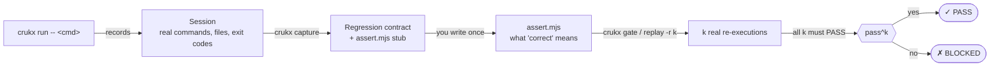
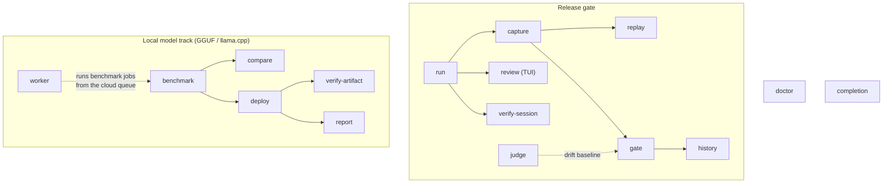
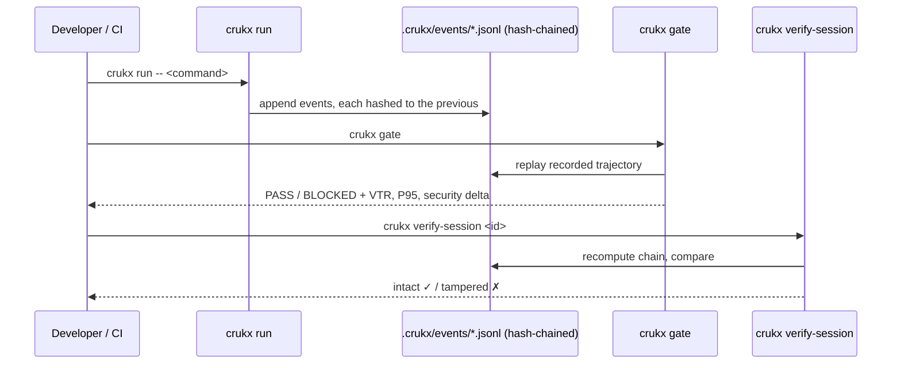
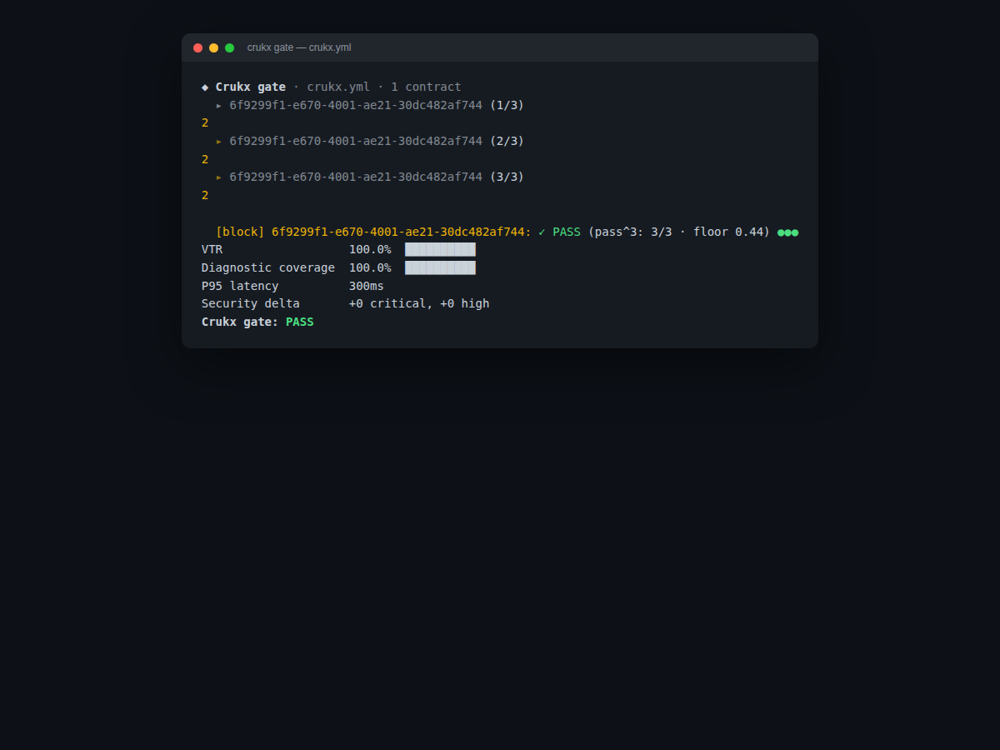
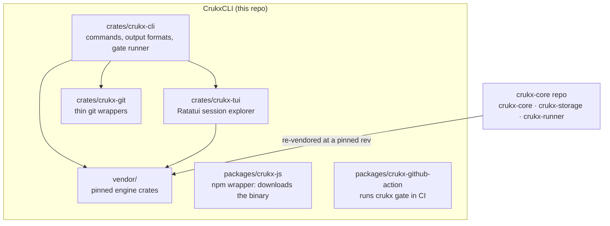
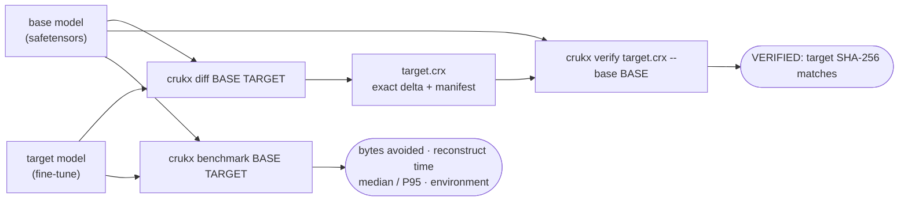

# Crukx CLI

The `crukx` command. Today it is a **release gate for AI-agent workflows**:
it replays real recorded agent sessions and returns **PASS** or **BLOCK**
before you ship. It also benchmarks and packages local models (GGUF via
llama.cpp). It runs offline and needs no account.

> **Where Crukx is heading.** Crukx is becoming the **control plane for model
> efficiency**: exact model deltas, verification and benchmarks. The first new
> commands are planned below ([§5](#5-whats-next-planned-not-built-yet)) and
> are **not in this binary yet**. Everything in §1–§4 works today, and
> `crukx gate` keeps its behavior and exit codes through the transition.

---

## 1. The 30-second version

```bash
crukx run -- npm test   # record a real session (commands, files, exit codes)
crukx capture           # turn it into a regression contract (+ assert.mjs stub)
crukx gate              # replay every contract in crukx.yml → PASS / BLOCKED
```



Nothing is simulated or scored by an LLM. Every number on the gate report
comes from a real process that ran. A contract can be replayed `k` times, and
it passes only if **all k** runs pass (pass^k). A workflow that fails 1 run in
5 hasn't earned a PASS.

## 2. Every command today



| Command | What it does |
|---|---|
| `crukx run -- <cmd>` | Runs a command as a recorded session (hash-chained event log in `.crukx/events/`) |
| `crukx capture [session]` | Turns a session into a regression contract + `assert.mjs` stub |
| `crukx replay <id> [-r k]` | Replays one contract; `-r k` reports pass^k |
| `crukx gate` | Replays every contract in `crukx.yml` and applies its constraints. Exit 0 = PASS, 1 = BLOCKED. `--format json\|junit\|markdown`, `--fail-on-regression` |
| `crukx history` | Sparkline trends of VTR / P95 across recent runs (`--json` for scripts) |
| `crukx review [session]` | Terminal UI over a recorded session |
| `crukx verify-session <id>` | Proves a session log wasn't edited, truncated or reordered |
| `crukx judge` | Measures an LLM judge's agreement with a human-labeled set; `gate` uses it to detect judge drift |
| `crukx benchmark <model.gguf>` | Detects the device, runs a GGUF model N times via llama.cpp, reports latency / tok/s |
| `crukx compare A.json B.json` | Compares two benchmark reports (refuses cross-hardware comparisons) |
| `crukx deploy` | Packages a benchmarked candidate as an artifact; the verdict comes only from a verifier file, never flags |
| `crukx verify-artifact <dir>` | Checks an artifact's manifest hash and evidence bundle |
| `crukx report <dir>` | Writes the evidence report (`REPORT.md`) for an artifact |
| `crukx worker` | Polls the Crukx control plane for benchmark jobs and runs them on this machine |
| `crukx doctor` | Checks the local install (git, node, state dir, API key) |
| `crukx completion <shell>` | Prints a shell completion script |

## 3. What `crukx gate` checks

Everything is configured in `crukx.yml` and every constraint is optional.

```yaml
contracts:
  - id: checkout-flow
    mode: block        # block (default) or warn
    repeat: 5          # pass^5
constraints:
  vtr_minimum: 0.9
  p95_latency_max_ms: 2000
  reliability_sla_minimum: 0.5
```

| Constraint | What it checks |
|---|---|
| `vtr_minimum` | Fraction of contracts that PASSed (Verified Trajectory Rate) |
| `diagnostic_coverage_minimum` | Fraction of BLOCKs traced to a specific stage, not just "something broke" |
| `judge_max_agreement_drop` | LLM-judge drift vs. its calibration baseline |
| `security_critical_delta_max` / `security_high_delta_max` | New security findings introduced by the change |
| `p95_latency_max_ms` | P95 wall-clock time across replayed steps |
| `reliability_sla_minimum` | Each repeated contract's Wilson lower bound (pessimistic pass rate) must clear this |
| per contract `repeat: k` | pass^k |
| per contract `escalation:` | On BLOCK: accept / retry / escalate, from cost and the contract's own history |

`--fail-on-regression` also fails the run when a contract or VTR got worse
than the **last green run**. Logs are tamper-evident:





## 4. How this repo is put together



- **`crates/`**: everything you interact with at the command line.
- **`vendor/`**: an exact, pinned copy of the engine crates from the
  `crukx-core` repo. `.cargo/config.toml` points cargo at it, so the build
  never fetches the engine from GitHub. To update it, follow
  [`vendor/README.md`](./vendor/README.md); don't edit files there by hand.
- **`packages/`**: distribution. The npm shim (`@crukx/cli-rs`) picks the
  right prebuilt binary for your OS/libc. The GitHub Action installs `crukx`
  and runs `crukx gate` in a workflow.

### Build and test

```bash
cargo build -p crukx-cli                    # binary at target/debug/crukx
cargo test --workspace                      # unit + end-to-end tests
cargo clippy --workspace --all-targets -- -D warnings
cargo fmt --all -- --check
```

End-to-end tests (`crates/crukx-cli/tests/*_e2e.rs`) run the real built binary
in temp directories. CI (`.github/workflows/crukx-rs-ci.yml`) runs on Ubuntu,
macOS, Windows and several Linux distros.

## 5. What's next (planned, not built yet)

The design is in progress. Release 1 of the new direction ships three commands
on top of [`crukx-crx`](https://github.com/Crukx-dev/crukx-crx), the CRX
delta engine. They work on model weights alone, with no Python, no GPU and no
network:



| Release | Commands | Theme |
|---|---|---|
| R1 | `diff`, `verify`, `benchmark` | Prove the exact delta |
| R1.x | `push`, `pull` | Distribute CRX artifacts |
| R2 | `serve`, `scan` | Operate models |
| R3 | `sync`, `optimize` | Coordinate model infrastructure |

> Today's `crukx benchmark` measures **llama.cpp runtime latency**. The R1
> `benchmark` measures **base → target artifact economics**. How the two
> coexist is part of the design.

`crukx gate` will get a deprecation notice on stderr (output and exit codes
unchanged) and a `crukx migrate gate` helper that inspects and never deletes.

## 6. Glossary

| Term | Meaning |
|---|---|
| **Session** | One recorded run: JSONL events under `.crukx/events/` |
| **Contract** | Expected steps of a session + `assert.mjs` defining "correct" |
| **pass^k** | Passes only if **all** k replays pass |
| **VTR** | Verified Trajectory Rate: fraction of contracts that PASSed |
| **Last green** | The most recent PASS run in `.crukx/runs.jsonl`, the baseline for `--fail-on-regression` |
| **CRX** | Crukx's exact (lossless) model container / delta format (planned commands) |

## Security and license

Vulnerabilities: see [SECURITY.md](./SECURITY.md); don't open a public issue.

Apache License 2.0 ([LICENSE](./LICENSE)) covers the code in `crates/` and
`packages/`. The engine crates under `vendor/` come from the `crukx-core` repo
and are not covered by this license.
